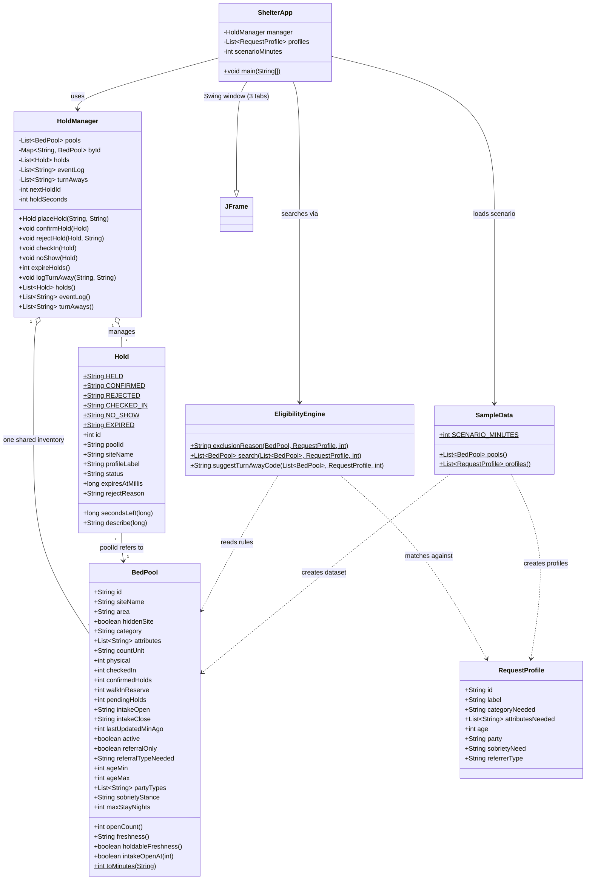
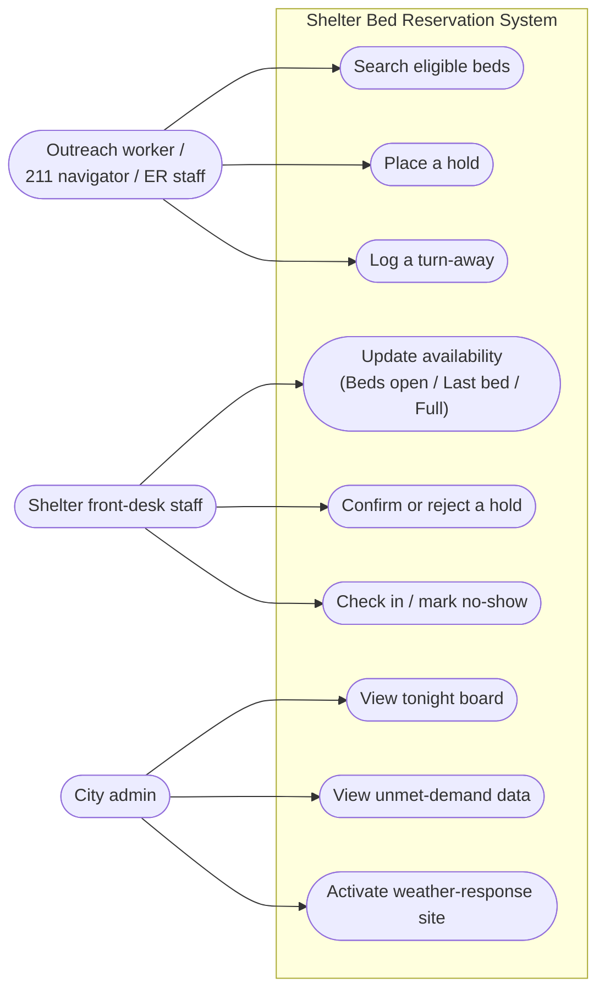
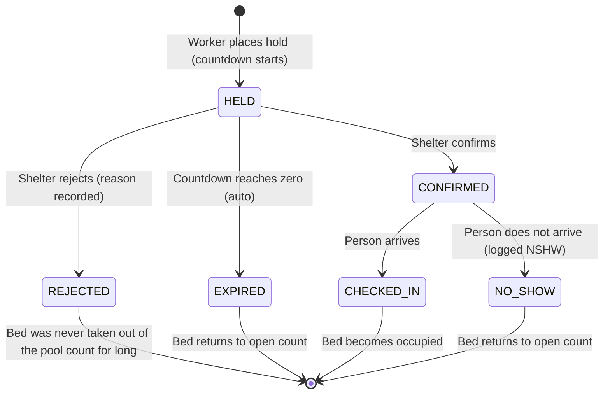

# UML Diagrams — Tucked In (Shelter Bed Reservation System)
**Drawn from the actual code** (package `shelterapp`, 7 classes). If the code changes, update this file in the same commit — that is the GitHub documentation rule for this project.
Diagrams are in Mermaid, which GitHub renders directly in markdown.

---

## 1. Class Diagram



**How to explain it in the presentation (30 seconds):** three data classes (`BedPool`, `RequestProfile`, `Hold`), two engines (`EligibilityEngine` decides what matches, `HoldManager` owns the live counts and every hold transition), one dataset (`SampleData`), one window (`ShelterApp`) with three tabs sharing the same `HoldManager` — that sharing *is* the "one live inventory" idea from the hotel model.

---

## 2. Use Case Diagram



---

## 3. Sequence Diagram — Sara's hold, end to end

```mermaid
sequenceDiagram
    actor W as Worker
    participant UI as ShelterApp (Worker tab)
    participant E as EligibilityEngine
    participant M as HoldManager
    participant C as Shelter Console
    actor S as Shelter staff

    W->>UI: Choose Sara profile, Search
    UI->>E: search(pools, Sara, 20:40)
    E-->>UI: Harbourview only (every other pool excluded, with reasons)
    UI-->>W: 1 eligible bed list + why the rest were excluded
    W->>UI: Place hold
    UI->>M: placeHold(pool-01) [synchronized]
    M-->>UI: Hold #1 HELD, countdown starts
    S->>C: Open hold inbox
    C->>M: confirmHold(#1)
    M-->>C: CONFIRMED (bed stays held)
    Note over W,S: Only now is Sara sent travelling -<br/>confirmation before travel
    S->>C: Arrivals -> Check in
    C->>M: checkIn(#1)
    M-->>C: CHECKED_IN (bed becomes occupied)

    opt Hold not confirmed in time
        M->>M: expireHolds() runs every second
        M-->>UI: Hold EXPIRED, bed returns to the pool
    end
    opt Two workers race for the last bed
        M->>M: placeHold is synchronized: check + decrement in one step
        M-->>UI: Exactly one worker wins; the other is told instantly
    end
```

---

## 4. State Diagram — the Hold lifecycle



**The one rule to say out loud:** a bed's open count only ever changes inside `HoldManager`, one transition at a time — that is why the system can promise *no overselling*.
